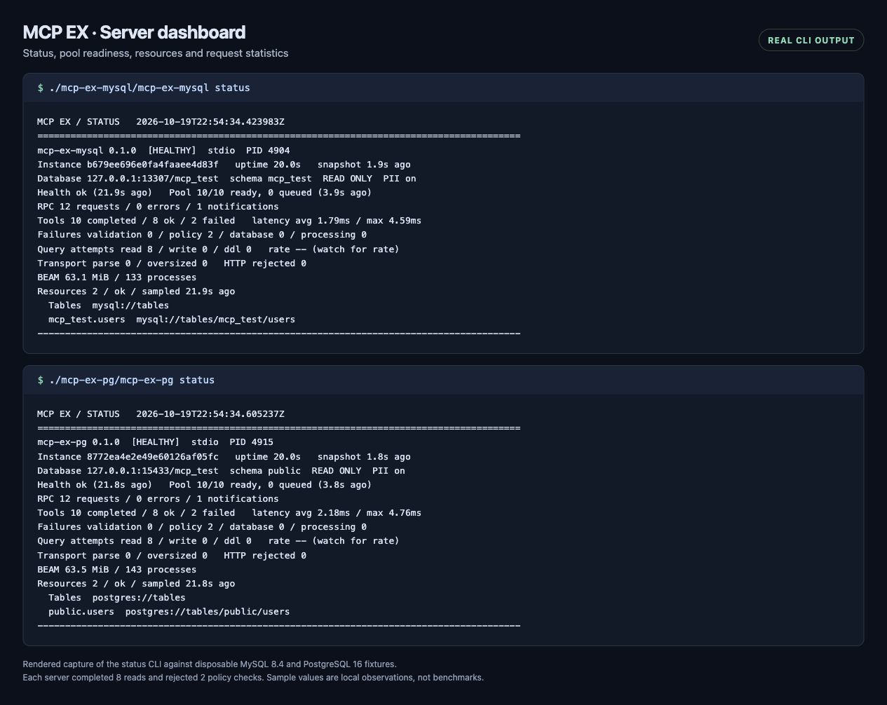

# Elixir database MCP servers

Connect an MCP client to MySQL or PostgreSQL through SQL tools and table metadata
resources. Both servers are written in Elixir, run over stdio or authenticated
HTTP, with a supervised Elixir process per MCP session. Writes are disabled by default.

Status as of 2026-10-19: the three defects from the
[completion audit](.worklog/audit-2026-10-19.md) are fixed, runtime security
dependencies are patched, and the full check and Hex audits pass. Both escripts now include an optional
[local CLI dashboard](docs/DASHBOARD.md). See the
[fix log](.worklog/fixes-2026-10-19.md) for regression evidence and verification limits.

2026-10-20: both transports now use supervised MCP session processes and bounded
query workers. Stdio input is buffered and pings remain responsive during SQL.
See the [session implementation and measurements](.worklog/session-implementation-2026-10-20.md).

| Project | Purpose | Tool | Resource URI |
| --- | --- | --- | --- |
| [mcp-ex-mysql](mcp-ex-mysql/README.md) | MySQL server using MyXQL | `mysql_query` | `mysql://tables[/database/table]` |
| [mcp-ex-pg](mcp-ex-pg/README.md) | PostgreSQL server using Postgrex | `pg_query` | `postgres://tables[/schema/table]` |
| [mcp-ex-core](mcp-ex-core/README.md) | Shared configuration, MCP, transports, SQL policy and PII masking | Used by both servers | Used by both servers |

The adjacent [mcp-server-mysql](mcp-server-mysql/README.md) is the TypeScript
reference implementation. Keep the three Elixir folders together: both
applications depend on `../mcp-ex-core`. Plug and Bandit serve HTTP; there is no
web UI or Phoenix application.

## Documentation

Start with the [documentation index](docs/README.md), or open a guide directly:

- [User guide](docs/USER-GUIDE.md): install with asdf, build, connect clients, query and discover tables.
- [Configuration reference](docs/CONFIGURATION.md): every environment variable, defaults and precedence.
- [Security and SQL policy](docs/SECURITY.md): write permissions, read-only transactions, PII and supported SQL.
- [Dashboard](docs/DASHBOARD.md): status, watch, resources, statistics and private snapshots.
- [Operations](docs/OPERATIONS.md): HTTP deployment, TLS, sockets, tunnels, monitoring and upgrades.
- [Developer guide](docs/DEVELOPER-GUIDE.md): architecture, module contracts, extension points and contribution workflow.
- [Testing](docs/TESTING.md): local checks, disposable databases and official MCP SDK interoperability.
- [Troubleshooting](docs/TROUBLESHOOTING.md): startup failures, protocol errors and query restrictions.

## Quick start

With asdf and its Erlang/Elixir plugins installed, run from this directory:

```sh
KERL_CONFIGURE_OPTIONS='--without-javac --without-wx --without-odbc' asdf install
mix local.hex --force
mix local.rebar --force
for project in mcp-ex-core mcp-ex-mysql mcp-ex-pg; do
  (cd "$project" && mix deps.get)
done
(cd mcp-ex-mysql && mix escript.build)
(cd mcp-ex-pg && mix escript.build)
```

[First-time plugin setup](docs/USER-GUIDE.md#install-and-build) is in the user
guide. [.tool-versions](.tool-versions) pins Erlang 28.5 and Elixir
1.20.4-otp-28; the Mix projects require Elixir 1.18 or newer. Built escripts
bundle Elixir and dependencies and still require Erlang's `escript` on `PATH`.

Choose a server and supply credentials for an existing database account. These
commands start the stdio transport; an MCP client supplies the protocol messages.

```sh
MYSQL_HOST=127.0.0.1 MYSQL_PORT=3306 MYSQL_USER=reader MYSQL_PASS=replace-me MYSQL_DB=app \
  ./mcp-ex-mysql/mcp-ex-mysql --stdio
```

```sh
PG_HOST=127.0.0.1 PG_PORT=5432 PG_USER=reader PG_PASS=replace-me PG_DB=app PG_SCHEMA=public \
  ./mcp-ex-pg/mcp-ex-pg --stdio
```

Use [client configuration](docs/USER-GUIDE.md#connect-a-stdio-client) for normal
usage. `.env` files must be exported explicitly. Restart the process after
changing configuration.

## Server dashboard

Add `MCP_DASHBOARD=true` to your MCP server's environment and restart it.
In another terminal under the same account:

```sh
./mcp-ex-mysql/mcp-ex-mysql status
./mcp-ex-pg/mcp-ex-pg status --watch
./mcp-ex-pg/mcp-ex-pg status --json
./mcp-ex-pg/mcp-ex-pg resources --instance INSTANCE_ID
```

Copy `INSTANCE_ID` from `status`. The viewer reads private local snapshots and
needs no database credentials. It shows uptime, database-health/sample ages,
pool readiness/queue length, BEAM memory/processes, aggregate request/query
statistics and cached resource names. Ctrl+C stops only the viewer.



Browser-rendered screenshot of real CLI output from the disposable fixtures:
each server completed eight reads and rejected two policy checks. The
application runs in your terminal; the screenshot frame is documentation only.
SQL, parameters, returned rows and credentials are excluded from snapshots.
Read [dashboard setup, metric definitions and reproduction](docs/DASHBOARD.md)
for custom directories, JSON/watch behavior, freshness and exit codes.

## Behavior and limits

Each tool accepts one SQL statement and an optional array of bound values.
Reads use database-enforced read-only transactions. Simple writes and table DDL
require operation/schema permissions. PostgreSQL connects to one database per
process; its multi mode discovers schemas in that database. MySQL table DDL
implicitly commits.

Optional PII mode guards SQL identifiers, filters column metadata and masks
returned values. Detection is heuristic. Database grants govern indirect effects
through functions, triggers and views. The SQL policy deliberately rejects
ambiguous or unsupported statements. Responses default to an 8 MiB limit and have no pagination;
use explicit projections and `LIMIT`. See the [security guide](docs/SECURITY.md).

HTTP uses `POST /mcp`, exact static bearer authentication and JSON responses.
Initialization issues an `MCP-Session-Id` that clients reuse on subsequent requests.
Sessions support cancellation and DELETE, and expire after five idle minutes by
default. There is no SSE stream, durable session storage, OAuth server or browser CORS preflight.
See [HTTP operation](docs/OPERATIONS.md#run-http) for headers and examples.

## Performance before and after MCP sessions

Benchmarked on 2026-10-20 using clean builds of `b542550` (before) and `9646c0a`
(after session processes, bounded query workers and buffered stdio). Values below
are **before → after, in milliseconds**, using the median of five samples after
ten warm-up queries. Lower is better.

| Server | Transport | `SELECT 1` | Four concurrent 200 ms queries | Ping behind a 300 ms query | Ping with 256 KiB input padding |
| --- | --- | ---: | ---: | ---: | ---: |
| MySQL | stdio | 1.77 → 1.16 | 831.15 → 206.93 | 278.76 → 0.39 | 4,531.43 → 1.03 |
| PostgreSQL | stdio | 1.83 → 1.60 | 839.04 → 208.38 | 277.39 → 0.36 | 4,311.52 → 1.11 |
| MySQL | HTTP | 1.99 → 1.66 | 208.12 → 207.94 | 2.13 → 2.09 | 1.50 → 1.27 |
| PostgreSQL | HTTP | 2.22 → 2.09 | 208.40 → 211.19 | 1.49 → 1.72 | 0.99 → 1.38 |

Stdio completed the four-query batch **about 4× faster** on both servers.
Pings finished ahead of the slow query in every after sample; previously stdio
pings waited for it. Buffered input reduced the large padded ping from over four
seconds to about one millisecond. HTTP already handled concurrent requests, and
its batch latency remained around 208–211 ms.

Both revisions used the same disposable Docker fixtures, pool size 10, one
client/session at a time, and disabled dashboard/PII redaction; the new session
allowed four query workers. Host: Apple M5 Max, 64 GiB RAM, macOS 27.0.1,
Erlang 28.5 / Elixir 1.20.4; databases: MySQL 8.4.11 and PostgreSQL 16.15.
Initialization/startup is excluded. The ping was sent 30 ms after the slow query.

These local sleep-query and framing tests measure concurrency and latency, not
production SQL throughput. Five samples do not establish tail latency or the
significance of small timing differences. That comparison did not measure
CPU/memory usage or sustained load; the stress test below covers those separately.
See [methodology and reproduction](docs/benchmarks/README.md),
[all samples and environment](docs/benchmarks/session-processes-2026-10-20.json),
and the [benchmark harness](test/benchmark.mjs).

## Local stress benchmark

The throughput test uses `SELECT 1 AS value` through the complete MCP SQL tool
path, including SQL policy, a read-only database transaction and result
validation. It runs the client, one MCP server and disposable Docker databases
on the same laptop. The [stress methodology](docs/benchmarks/STRESS.md) describes
the concurrency sweep, overload checks and reproduction commands.

### Confirmed throughput

Highest error-free candidates from the concurrency sweep, confirmed with **three
30-second runs** each. RPS below is the median of those runs; latency percentiles
combine all successful requests from those confirmations.

| Server / transport | Successful RPS | Concurrent requests | p95 (ms) | p99 (ms) |
| --- | ---: | ---: | ---: | ---: |
| MySQL / stdio | **9,003** | 124 | 17.35 | 20.10 |
| MySQL / HTTP | **12,963** | 124 | 12.65 | 15.60 |
| PostgreSQL / stdio | **8,399** | 88 | 13.45 | 15.80 |
| PostgreSQL / HTTP | **10,221** | 92 | 11.60 | 14.15 |

These results use temporary pool/per-session limits of **128 for MySQL** and
**96 for PostgreSQL**. Stdio has one session; HTTP has four sessions and four
load-generator threads. Repository defaults remain pool 10 / per-session limit
4. Dashboard and PII redaction were disabled; HTTP and database traffic used
local connections without TLS.

The selected configurations completed **3,645,110 successful requests** across
the twelve confirmation runs with zero errors or busy replies. Overload
rejections and rejected candidates are retained in the raw results and excluded
from the headline rates. A bound lookup of the fixture's one-row table reached
8,820 / 12,646 RPS for MySQL and 8,174 / 10,154 RPS for PostgreSQL (stdio / HTTP).

During confirmations, BEAM averaged about **5.4–5.7 CPU cores**, with sampled
process RSS peaks of **148–192 MiB**; database/VM resource use is separate.
These are observed local peaks for tiny, hot reads within the tested settings.
Larger queries/results, writes, production networks and longer soak tests need
separate measurements. See [full results and reproduction](docs/benchmarks/STRESS.md),
[raw phases, histograms and environment](docs/benchmarks/stress-2026-10-20.json),
and the [stress harness](test/stress.mjs).

### Test machine and versions

Recorded locally on 2026-10-20; application source: `d69485f`.

| Component | Version / specification |
| --- | --- |
| Laptop | MacBook Pro `Mac17,6`, AC power |
| Processor | Apple M5 Max, arm64; 18 CPU cores (6 Super + 12 Performance) |
| Memory / GPU | 64 GiB unified memory; 40-core GPU (unused by the test) |
| Storage | 2 TB APPLE SSD AP2048Z; database fixtures use tmpfs |
| macOS | 27.0.1, build 26A434 |
| Elixir | 1.20.4 |
| Erlang/OTP | 28.5, ERTS 16.4, JIT, 18 online schedulers |
| MySQL / driver | 8.4.11 / MyXQL 0.9.0 |
| PostgreSQL / driver | 16.15 / Postgrex 0.22.4 |
| Shared pool / HTTP | DBConnection 2.10.2; Bandit 1.13.1; Plug 1.20.3 |
| Docker | Desktop 4.92.0, Engine 29.8.0; VM: 18 CPUs, about 7.75 GiB RAM |
| Load generator | Node.js 26.8.2 |

## Verify

After fetching dependencies for all three projects:

```sh
./bin/check
```

For real database and SDK checks, run from the workspace root:

```sh
(
  set -eu
  trap 'docker compose -f compose.test.yml down' EXIT
  docker compose -f compose.test.yml up -d --wait
  npm --prefix test ci --ignore-scripts
  MCP_INTEGRATION=true ./bin/check
)
```

The fixtures use disposable tmpfs storage and loopback database ports
13307 and 15433. SDK tests also need ports 13007 and 13008. Node and Docker are
needed only for integration checks. Tests mutate fixtures; use the supplied test environment.
[Testing instructions and coverage](docs/TESTING.md) explain the checks and
remaining verification limits. `bin/check` uses RTK when available.

Tasks and evidence are tracked in [.worklog/status.md](.worklog/status.md);
implementation decisions are in [.worklog/analysis.md](.worklog/analysis.md).
MIT license and reference-project attribution: [LICENSE](LICENSE).
