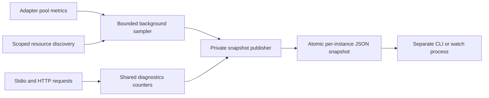

# MCP server dashboard plan

Implemented on 2026-10-19. This document preserves the design rationale;
[Dashboard](DASHBOARD.md) documents the shipped commands, exact semantics,
screenshot and limits. Verification is recorded in the
[implementation log](../.worklog/dashboard-2026-10-19.md).

Originally proposed on 2026-10-19 for both database servers and transports.
The implementation uses query attempts per second for the watch rate rather
than completed tool calls per second; all shipped semantics are in the guide.

## Recommendation

Build a separate read-only CLI with a live `--watch` view. Let each running
server optionally publish a private local JSON snapshot. Reuse that snapshot
for plain text, JSON and terminal display.

This gives useful status/resources/statistics without Phoenix, a terminal UI
dependency, another listener, or database credentials in the viewer. A richer
TUI can come later if keyboard navigation becomes useful. If a browser interface
is later required, use Phoenix/LiveView as requested for this project.

| Option | Fit | Extra work | Decision |
| --- | --- | --- | --- |
| CLI snapshot and ANSI watch | Same-host operation, SSH, scripts, stdio and HTTP instances | Optional collector, private snapshot files and renderer | Recommended first release |
| Interactive TUI | Keyboard navigation, sorting, large inventories | Terminal input/resize lifecycle and more interaction tests | Add after the data interface is useful |
| CLI querying an admin HTTP interface | Remote inspection and on-demand refresh | Auth, routes/listeners, ports, instance discovery and access policy | Defer until remote access is required |
| Phoenix LiveDashboard/LiveView | Browser-based operations | Phoenix endpoint, LiveView and authentication; MCP-specific resource/stat pages still needed | Too much setup for the first release |
| Parse logs or launch another MCP client | Quick inspection of a new connection | No reliable observation of the original process's statistics | Does not meet the running-instance requirement |

The existing standard library supports ANSI formatting and screen/cursor control;
a basic watch view needs no terminal package.
[IO.ANSI documentation](https://elixir.hexdocs.pm/1.20.4/IO.ANSI.html).
Phoenix LiveDashboard supplies general runtime/telemetry pages, but requires
LiveView setup and protected access; it would still need MCP-specific inventory
and request statistics.
[LiveDashboard documentation](https://phoenix-live-dashboard.hexdocs.pm/Phoenix.LiveDashboard.html).

## What exists today

- [`McpEx.CLI`](../mcp-ex-core/lib/mcp_ex/cli.ex) loads configuration, starts one
  pool, probes it with SELECT 1, then runs stdio or Bandit. It has no status
  command or running-instance registry.
- [`McpEx.Server`](../mcp-ex-core/lib/mcp_ex/server.ex) handles requests for both
  transports. It already knows tool results, policy rejections and resource
  requests. The displayed query timing starts after policy checking and includes
  driver execution and result processing; it is not full request latency.
- [`McpEx.HTTP`](../mcp-ex-core/lib/mcp_ex/http.ex) handles failures before the
  dispatcher, including authentication, Origin, media-type and body errors.
- [`MySQL`](../mcp-ex-mysql/lib/mcp_ex/mysql.ex) and
  [`PostgreSQL`](../mcp-ex-pg/lib/mcp_ex/pg.ex) already expose scoped table/column
  discovery and native read-only execution. Reuse these rules.
- There are no cumulative counters, inventory cache, `/health` or `/metrics`
  interface. MCP `ping` only proves dispatcher responsiveness.
- DBConnection 2.10.2 already exposes `get_connection_metrics/2`, returning
  ready connection and checkout-queue counts. The installed pool implementation
  uses an infinite GenServer-call timeout: sample it in a bounded worker, never
  directly in a request handler or terminal renderer.
  [Public interface source](https://github.com/elixir-ecto/db_connection/blob/v2.10.2/lib/db_connection.ex),
  [pool implementation](https://github.com/elixir-ecto/db_connection/blob/v2.10.2/lib/db_connection/connection_pool.ex).

The main constraint is stdio ownership. The MCP client owns server stdin/stdout;
an in-process terminal screen or competing reader would break the protocol.
The viewer must be a different process. It must observe the existing instance,
not quietly start a new pool/server whose counters begin at zero.

## Proposed user experience

Enable publishing when starting a server, including through an MCP client's
environment configuration:

```sh
# Proposed commands; export the normal database settings first.
MCP_DASHBOARD=true ./mcp-ex-mysql/mcp-ex-mysql --stdio
```

In a separate terminal:

```sh
# Proposed commands; these do not connect to the database or start MCP.
./mcp-ex-mysql/mcp-ex-mysql status
./mcp-ex-mysql/mcp-ex-mysql status --instance example-id --watch
./mcp-ex-mysql/mcp-ex-mysql status --instance example-id --json
./mcp-ex-mysql/mcp-ex-mysql resources --instance example-id
./mcp-ex-pg/mcp-ex-pg status --watch
```

`status` lists observed instances of the executable's dialect. Resource commands
require an instance ID when more than one live candidate exists. Display a clear
message when publishing is disabled or no snapshots exist. Do not silently fall
back to starting a database connection.

`--watch` refreshes every two seconds. On a terminal, redraw using ANSI; outside
a terminal, print timestamped text without cursor escapes. JSON output has no
colors; `--watch --json` can emit one JSON object per refresh as JSON Lines.
Ctrl+C stops only the viewer. The first rate sample is unknown; subsequent
samples use counter deltas for the same instance ID.

Illustrative screen, with sample values rather than measured runtime evidence:

```text
mcp-ex-pg 0.1.0    instance 8fa2...    stdio    uptime 02:14:08
Snapshot: fresh, 1s old    DB probe: OK, 12s old
Database: app             Schema: public
Writes: disabled          PII: enabled

Requests       1,284       RPC errors       3
Tool calls     1,100       Policy rejected  12
DB attempts    1,088       DB failures      4
Tool latency   avg 8.4ms   max 245ms
Recent rate    2.1/s       Pool ready       9 / configured 10
Checkout queue 0          BEAM memory      42 MiB

Resources: 28    refreshed 34s ago    showing 28
postgres://tables                      Tables
postgres://tables/public/users         public.users
postgres://tables/public/orders        public.orders
```

## First-release information and statistics

| Area | Show | Meaning/limit |
| --- | --- | --- |
| Identity | Instance ID, PID, dialect, version, transport, uptime | A new ID on every start; PID alone is not identity |
| Configuration | Effective host/port, database/schema, write capability and PII state | Explicit allowlist; never dump the config/connection map |
| Freshness | Last publish time and age | A fresh heartbeat is not proof of MCP or database health |
| DB health | Probe result, age, duration, last success and safe error category | Separate from last successful user query and pool pressure |
| MCP traffic | Requests, notifications, RPC errors, calls by known method | Unknown method names share one bucket; no per-client labels |
| Tools | Completed calls, successes, validation failures, policy rejections, DB failures and processing failures | A tool `isError` is not necessarily a JSON-RPC error |
| Query attempts | Read/write/DDL attempts after policy acceptance | Driver invocation count; do not claim every attempt reached or committed in the database |
| Latency | Completed tool-call average and maximum, including failed calls | Define the timed span and denominator; no invented p95 |
| Rate | Completed tool calls/second between watch samples | Reset on restart; single snapshots do not contain a recent rate |
| Pool | Ready connections, configured pool size, checkout queue and sample age | Ready/configured does not equal active/total; connecting and broken connections matter |
| Resources | Count, names, URIs, refresh age and truncation | Same scope as MCP resource discovery; not table data |
| Runtime | BEAM memory and process count | VM memory, not OS RSS; no unsupported CPU percentage |

Counters are per instance, since start, and reset on restart. Notifications and
ignored client response envelopes are not requests. Internal probes/inventory
refreshes must not inflate client traffic, tool counts, query attempts or
latency. HTTP rejections and stdio parse/size errors need separate transport
counters because they never reach `Server.handle/3`.

Do not show active/unique clients: HTTP is stateless and neither transport has
an authenticated per-client identity suitable for that count. Defer exact
in-flight query counts until process-death/cancellation cleanup is implemented;
pool ready/queue measurements provide useful pressure information immediately.

## Collection and snapshot design



Use two shared modules initially:

- `McpEx.Diagnostics`: optional counter state, outcome/timing observation,
  bounded sampling, safe snapshot construction and publication.
- `McpEx.Monitor`: snapshot discovery/validation, instance selection, plain/JSON
  output and ANSI watch rendering.

The diagnostics interface should stay small: start it for an instance, observe
a bounded event, and obtain/publish a safe snapshot. Keep collection and output
details behind that interface. No plugin registry or general monitoring framework
is needed.

Use ETS for fixed-label counters/elapsed totals, avoiding disk I/O and slow
GenServer calls on the request path. The optional publisher owns the state and
monitors the MCP owner process. It must not be linked so that its failure can
terminate the MCP process; publishing failures leave stale/unknown diagnostics,
not failed user queries. Recording into missing/dead diagnostics state is a
no-op, preserving the original result/exception. Bound labels and retained state;
do not queue every query as an unbounded list of events.

Publish every two seconds. Refresh pool data about every five seconds, run a
read-only SELECT 1 probe every 30 seconds, and refresh resources every 60 seconds.
These are initial fixed defaults, not four new configuration knobs. Run initial
inventory collection asynchronously after successful startup. Carry age/status
for each sample independently; a fresh file must not make an old DB probe look
fresh.

At most one background sampling job runs per instance. Pool metric calls get
a bounded worker deadline; probes/metadata get a short query/checkout budget
(initial target: two seconds). A blocked worker cannot stop heartbeat publishing.
The sampler never runs on the MCP request process. Reuse the existing pool for
the first release and report contention as a timed-out/degraded probe rather
than assert that the database is down. A dedicated monitoring pool is deferred
unless measured contention justifies the added connections.

Reuse the existing resource-list path with diagnostics recording disabled for
that internal call, rather than duplicate discovery SQL/URI/scoping rules.
Preserve the last good resource inventory after refresh failure, with its old
timestamp and an explicit error marker. An unknown inventory is not an empty
database. Retain at most 200 resource entries in the snapshot, with full reported
count and `truncated` state; do not retain table data or column-default values.
The existing discovery call still materializes its full result transiently:
this cap bounds retained/output inventory, not the driver's query result memory.

For later column browsing, reuse MCP column filtering and explicitly omit
defaults/other value-bearing metadata from diagnostic snapshots. It is outside
the initial CLI's resource-list scope.

## Storage, safety and lifecycle

Proposed settings:

| Setting | Default | Purpose |
| --- | --- | --- |
| `MCP_DASHBOARD` | `false` | Enable collection and snapshot publishing |
| `MCP_DASHBOARD_DIR` | `$XDG_STATE_HOME/mcp-ex`, falling back to `~/.local/state/mcp-ex` | Shared location for server and viewer |

Each process writes `<instance-id>.json`, with a versioned schema, instance ID,
start time, publish sequence/time, monotonic uptime, safe identity, metrics,
health and resource inventory. Generate the ID independently of the PID. Separate
files avoid collisions when several MCP clients launch servers simultaneously.

Create/validate a private directory (0700) and private files (0600). Reject
symlinks and unsafe ownership/permissions on supported Unix platforms; do not
chmod arbitrary existing shared directories. Write a private temporary file,
then rename it in the same directory so the viewer sees a complete snapshot.
Limit accepted snapshot size (initial target: 1 MiB) and validate its schema.
Do not enable publishing when the directory cannot be made safe; report the
diagnostics failure on stderr and let the existing MCP functionality continue.

The viewer never needs DB passwords, MCP bearer tokens, client headers or Erlang
distribution cookies. Snapshot construction uses an allowlist, never
`inspect(config)`. Exclude SQL text, parameters, result values, raw error messages,
client identities and credentials. This applies even when PII mode is disabled.
Escape control characters from resource names and labels before terminal output.
Diagnostic data remains visible to the same OS user and administrators; private
files are not a separation between applications running as the same user.

Mark a snapshot stale after about ten seconds without an update. Call it
`stale/unknown`, not definitively dead: a stalled publisher and a stopped server
are different situations. Do not declare a file live just because its PID has
been reused. Remove its own snapshot on normal shutdown where possible; crashes
can leave stale files. The viewer is read-only and never deletes arbitrary files
or stops server processes. Detect timestamp anomalies and show unknown freshness
rather than a negative age/healthy state.

Suggested CLI exit codes: 0 for selected fresh/healthy instances, 1 for
stale/degraded/unknown or no observed instances, 2 for usage/selection or
snapshot-read/schema errors. Return the structured state in JSON as well.

A server must be restarted with publishing enabled before it can be observed.
There is no retrospective history or attachment to an uninstrumented process.
For remote use in this first release, run the viewer over SSH as the same OS
user; the private files are not an HTTP interface or a multi-host collector.

## Concrete changes

| File/module | Planned change |
| --- | --- |
| [`config.ex`](../mcp-ex-core/lib/mcp_ex/config.ex) | Validate the opt-in and directory; derive safe display fields explicitly |
| [`cli.ex`](../mcp-ex-core/lib/mcp_ex/cli.ex) | Parse monitor commands before DB configuration/pool startup; start optional diagnostics for server mode |
| [`server.ex`](../mcp-ex-core/lib/mcp_ex/server.ex) | One observation wrapper for RPC outcomes; record known tool stages/modes without changing returned envelopes |
| [`http.ex`](../mcp-ex-core/lib/mcp_ex/http.ex) and stdio framing | Count transport-level failures without retaining request bodies/headers |
| `diagnostics.ex` (new) | Fixed-label state, safe snapshot, asynchronous sampling and atomic publication |
| `monitor.ex` (new) | Read-only CLI, JSON and watch display |
| Both database adapters | Small `pool_metrics(context)` function using their installed DBConnection dependency |
| Tests/client script | Counter semantics, failure isolation, snapshots and real escript compatibility |
| READMEs and docs | Enablement, command reference, metric definitions, privacy and stale-state behavior |

The pool-metrics adapter function keeps DBConnection out of the shared core's
direct dependencies. Both adapters already depend on it through their drivers.
Fake adapters supply deterministic metric samples for core tests.

No change to `/mcp`, advertised MCP tools/resources, bearer authentication or
SQL write permissions is needed. No new runtime packages are required for this
first release.

## Implementation sequence and acceptance

1. **Collector and counters.** Add disabled-by-default diagnostics, safe identity
   and fixed-label counters. Test success, invalid arguments, policy rejection,
   database error, processing error, notification, unknown method, parse error and
   HTTP rejection. Verify exact counter categories and monotonic timing without
   storing SQL or double-counting internal calls.
2. **Publication and inspection.** Add private per-instance snapshots and
   `status --json`/plain output. Test concurrent instances, restart identity,
   atomic replacement, stale/unknown data, unreadable/invalid/oversized files and
   safe file permissions. Inspection must work without database credentials and
   must not create a driver pool.
3. **Resources and watch.** Add bounded asynchronous health/pool/inventory
   sampling and watch rendering. Show unknowns, sample ages and truncation.
   Test counter resets, no-ANSI output, terminal-control escaping and viewer
   cancellation without server shutdown.
4. **Integration and documentation.** Extend `MCP_INTEGRATION=true ./bin/check`
   with publishing enabled for real MySQL/PG stdio and HTTP instances. Verify
   healthy, rejected and timed-out requests, metadata scope, PII-safe snapshots,
   JSON-only MCP stdout, multiple simultaneous instances and cleanup. Keep
   the existing 16-test/SDK/error-path baseline passing, then document results.

Add explicit failure-isolation cases: unwritable/full snapshot storage, dead
publisher and a stuck pool-metrics worker must not change MCP results or block
requests. Measure instrumentation overhead separately from ordinary DB latency;
agree a budget from a repeatable baseline rather than invent performance claims.
Probe traffic must remain bounded and be reported separately from client usage.

## Deferred features and validation limits

Defer raw keyboard TUI controls, browser pages, remote admin listeners, persistent
history, p95/charts, Prometheus/OpenTelemetry export, query text/history, column
inspection, exact active-client counts and lifecycle/write controls. Add those
only for a concrete operator need, using the same safe snapshot interface where
appropriate. If server-wide metrics are later exposed over HTTP or Phoenix,
design authentication and remote access separately from the local file reader.

The original proposal was based on source and primary library documentation.
The collector, status/resources/watch commands, tests and screenshot are now
implemented. The screenshot is a rendered capture of real CLI stdout. A runtime
instrumentation benchmark, full-disk fault injection and production/load
validation remain deferred; no throughput/overhead claim is made. Earlier server
verification remains in [the fix log](../.worklog/fixes-2026-10-19.md).
