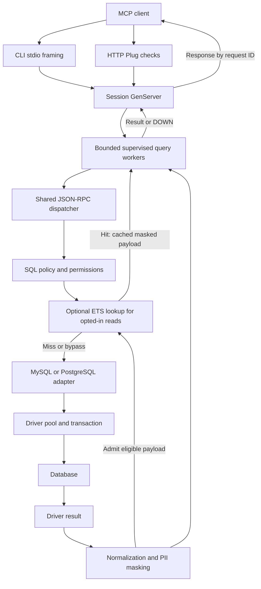

# Developer guide

The implementation uses two small Mix applications and one sibling library.
MyXQL and Postgrex own database connectivity; the shared core owns configuration,
SQL policy, MCP request handling, normalization/masking and transports. There is
no Ecto layer, Phoenix application or custom database protocol. The browser
dashboard uses Plug/Bandit and the existing private diagnostic snapshots.

## Workspace layout

| Path | Responsibility |
| --- | --- |
| [`mcp-ex-core/mix.exs`](../mcp-ex-core/mix.exs) | Shared dependency declarations; Jason, Plug, Bandit and Decimal |
| [`config.ex`](../mcp-ex-core/lib/mcp_ex/config.ex) | Environment parsing, driver options, write permission lookup and tool capability hints |
| [`policy.ex`](../mcp-ex-core/lib/mcp_ex/policy.ex) | SQL lexer, single-statement classification, target checks and PII query guards |
| [`redact.ex`](../mcp-ex-core/lib/mcp_ex/redact.ex) | Database value normalization, sensitive-name detection, recursive masks and metadata filtering |
| [`server.ex`](../mcp-ex-core/lib/mcp_ex/server.ex) | JSON-RPC dispatch, initialization, tools, resources, result envelopes and safe errors |
| [`cli.ex`](../mcp-ex-core/lib/mcp_ex/cli.ex) | Escript lifecycle, runtime startup/probe and transport choice |
| [`runtime.ex`](../mcp-ex-core/lib/mcp_ex/runtime.ex) | Rest-for-one supervision of the pool, optional cache, Registry, workers, sessions and HTTP listener |
| [`cache.ex`](../mcp-ex-core/lib/mcp_ex/cache.ex) | Optional bounded ETS query payload cache, monotonic expiry and write invalidation |
| [`session.ex`](../mcp-ex-core/lib/mcp_ex/session.ex) | Per-session lifecycle, active request IDs, bounded workers, cancellation, deadlines and idle expiry |
| [`stdio.ex`](../mcp-ex-core/lib/mcp_ex/stdio.ex) | Bounded raw input chunks, newline framing and one stdout writer |
| [`diagnostics.ex`](../mcp-ex-core/lib/mcp_ex/diagnostics.ex) | Optional ETS counters, private snapshots and bounded samplers |
| [`monitor.ex`](../mcp-ex-core/lib/mcp_ex/monitor.ex) | Status/resources rendering, JSON/watch, freshness and exit codes |
| [`dashboard.ex`](../mcp-ex-core/lib/mcp_ex/dashboard.ex) | Browser assets and token-protected access to one diagnostic snapshot |
| [`http.ex`](../mcp-ex-core/lib/mcp_ex/http.ex) | Plug handler, auth/origin/version checks, media types and bounded HTTP body handling |
| [`mysql.ex`](../mcp-ex-mysql/lib/mcp_ex/mysql.ex) | MyXQL pool, transaction execution, MySQL metadata SQL and CLI entry point |
| [`pg.ex`](../mcp-ex-pg/lib/mcp_ex/pg.ex) | Postgrex pool, startup parameters, transaction execution, schema metadata and CLI entry point |
| [`bin/check`](../bin/check) | Format/compile/strict Credo/test/build entry point for all three projects |
| [`test/`](../test) | Disposable SQL fixtures and official TypeScript SDK transport checks |
| [`compose.test.yml`](../compose.test.yml) | Local disposable MySQL/PostgreSQL databases |
| [`.worklog/`](../.worklog/status.md) | Task status, implementation decisions and verification evidence |
| [`mcp-server-mysql/`](../mcp-server-mysql/README.md) | Original TypeScript reference checkout |

Each application has its own `mix.lock`, `deps/` and `_build/`. The core is a
path dependency, not an umbrella application. Fetching an adapter application's
dependencies does not prepare the core's standalone build directory for its
own tests. Keep all three source folders together and fetch dependencies in each.

## Architecture and request flow



At startup, the dialect-specific CLI delegates to `McpEx.CLI.main/2`, which
first dispatches `status`/`resources` into the snapshot viewer. Server launch
validates configuration, starts `McpEx.Runtime` and probes its shared pool through the
read-only execution path. Optional diagnostics starts after this probe, unlinked
from the CLI owner, and monitors that owner for cleanup. The CLI then enters the stdio loop or starts Bandit with
the context map as Plug options. The runtime uses `:rest_for_one` with the pool,
optional cache owner, Registry, Task.Supervisor, DynamicSupervisor and Bandit in dependency order.
Replacing a dependency shuts down its dependent sessions and listener before
restarting them. Pool references use a registered name so restarts do not leave
stale PIDs in the context. Diagnostics remains an optional isolated observer.

Each session is a temporary GenServer: a crash invalidates the ID rather than
restarting empty state. A unique Registry resolves secure HTTP session IDs.
The session serializes lifecycle/control messages and starts query/resource
tasks under a shared Task.Supervisor. Global tasks are capped at pool size;
per-session work defaults to four. Capacity failures reject work immediately.
Active request IDs map directly to worker monitor references for duplicate
checks and cancellation; completion, cancellation and failure remove the ID.
Tasks link to the session and are monitored. The session traps task exits,
handles result/DOWN/deadline messages, and kills workers on termination. Links
also clean up workers if the session is killed before its terminate callback.
No task or database write is automatically retried.

Stdio has one session per executable. Its CLI process reads bounded chunks and
writes complete response frames while workers run separately. The writer
coalesces responses already waiting in the mailbox into a single write (at most
64 messages, stopping once 64 KiB is reached; an individual response may exceed
that threshold). There is no timer or wait to fill a batch. The one writer
preserves complete newline-delimited frames, and admission still waits for a
session acknowledgement to avoid an unbounded submission queue. The escripts
embed `-noinput` to disable OTP's competing stdin reader before opening the fd
port. EOF drains admitted work, including a final frame without a newline.
HTTP disconnects do not end logical sessions; explicit DELETE and idle expiry do.
Multiple stdio launches still have separate VMs and separate pools.

For `tools/call`, the server validates the tool and arguments and checks policy.
An opted-in read can reuse a cached JSON payload; otherwise it executes the
classified mode, builds row maps, filters SQL column metadata when needed and
applies normalization/masking. Each call builds its own response envelope,
request ID and timing. Hits keep the usual session worker and response limits.
Expected tool failures become `isError: true`; RPC dispatch errors use the
JSON-RPC error envelope.

Resources are a separate metadata path. The server calls adapter-owned
parameterized catalog queries, bypassing the user-SQL policy that would block
catalog access in PII mode. It validates a table resource against the current
table inventory before reading columns, applies column-name filtering and
normalizes metadata. This path does not run the complete value-masking pass.

## Cache ownership and invalidation

`McpEx.Cache` owns a protected named ETS set with `read_concurrency: true`.
Reads access ETS directly from query workers; a GenServer serializes admission,
expiry cleanup and write invalidation. No SQL runs inside that GenServer.
A metadata row records a unique generation and whether writes are active;
entries use `{generation, SHA256(scope, SQL, params)}` keys and store expiry plus
normalized/masked JSON. The generation is a fresh reference, including after
restart, so pre-write or previous-owner fills cannot repopulate current entries.

`Cache.with_write/2` fences permitted writes/DDL before adapter execution and
invalidates again afterward. It monitors each writer and clears its fence on
cancellation/crash. Multiple active writers keep the cache bypassed until the
last exits. Full invalidation avoids pretending this SQL lexer tracks every
view/function/trigger dependency. Read errors and ineligible fills are not stored.

The pool precedes the cache in `:rest_for_one`: a pool restart clears cache and
sessions; a cache crash clears entries and restarts dependent workers, sessions
and listener while preserving the pool. Stdio sessions then close; HTTP clients
reinitialize. There is no persistent/distributed cache or cross-instance
invalidation. Runtime configuration is immutable. See
[TTL, bounds and consistency limits](CONFIGURATION.md#optional-query-cache).

## Internal contracts

There is no declared Elixir adapter behaviour today; the two modules satisfy
the following convention. Keep shared policy out of adapters and native engine
details out of the core.

| Function | Contract |
| --- | --- |
| `dialect/0` | Returns `:mysql` or `:pg` |
| `start_link(config)` | Starts the driver pool and returns `{:ok, pool}` or a driver error |
| `execute(context, sql, values, mode)` | Accepts `:read`, `:write` or `:ddl`; returns `{:ok, result}` or `{:error, exception_or_reason}` |
| `tables(context)` | Returns a driver result with the canonical lowercase table metadata aliases |
| `pool_metrics(context)` | Returns DBConnection metric maps with `ready_conn_count` and `checkout_queue_length`; only the bounded diagnostic worker calls it |
| `columns(context, schema, table)` | Returns a driver result with canonical lowercase column aliases in ordinal order |

The request-handler context is `%{pool: pool, adapter: adapter_module, config: config}`
with optional `cache: cache_name_or_nil` and `diagnostics: %{pid: publisher, table: ets_table, instance_id: id}`. Missing/disabled
diagnostics are no-ops. Sampling contexts deliberately omit credentials, HTTP
tokens and the diagnostics handle.

`McpEx.Dashboard` serves embedded HTML/JavaScript and one instance's snapshot
through `Monitor.inspect_instances/3`. It uses a separate per-start viewing
token, never the MCP bearer token. `McpEx.HTTP` routes `/dashboard` requests to
it; stdio starts a dashboard-only Bandit listener when diagnostics are enabled.
Browser requests do not execute SQL or increment MCP HTTP counters.
Transport contexts additionally carry `registry`, `sessions` and `tasks`
supervisor references. Session messages carry either a GenServer call recipient
for HTTP or the stdio writer PID; the session tracks these by request ID and
worker monitor reference. Only bounded encoded responses cross back from workers.
The result needs `columns`, `rows` and `num_rows`; MySQL may also provide
`last_insert_id`. `columns: nil` selects the command-result envelope. Otherwise
`McpEx.Server.rows/1` zips column names and each row into a map; duplicate names
are overwritten by the later value. Preserve canonical metadata aliases,
particularly MySQL's explicit lowercase aliases.

`McpEx.Config.load/2` accepts an injected string-keyed environment map for
isolated tests. `Config.allowed?/3` is the permission lookup;
`Config.read_only?/1` supplies client annotations. Policy `check/2` returns
`%{mode: mode, schema: schema, introspection: kind}` or raises `ArgumentError`.
Introspection kinds are `nil`, `:columns`, `:topology` and `:blocked`.

Write target extraction accepts at most two name components; keep third-component
rejection in that shared path for every write/DDL classifier. File-SQL guards
inspect words and quoted identifiers while leaving literal values alone.

`McpEx.Server.handle/3` returns `{response_or_nil, next_state}`. Sessions pass
`:new`, transitions to `:initializing` on initialization, then to `:ready` on
`notifications/initialized`. HTTP validates initialization before allocating a
session and installs the negotiated version and `:initializing` state atomically.
Ready sessions dispatch independent work with the `:ready` handler in workers.
Incoming client response envelopes are ignored. Notifications
normally produce no response.

`Redact.normalize/1` runs independently of PII mode. `Redact.apply/2` adds
recursive masking when enabled. `filter_columns/2` operates on resource column
rows; `filter_introspection/2` accepts case-insensitive `Field` or `column_name`
keys and refuses a nonempty result shape that cannot be safely filtered.

## Database execution details

The MySQL adapter checks out one connection with `DBConnection.run/3`, applies
`SET TRANSACTION READ ONLY` using text protocol for the next read transaction,
then executes the user statement inside `MyXQL.transaction/3`. Reads deliberately
rollback with `{:read_result, result}` and unwrap that marker as success. Writes
commit. MySQL DDL uses a direct query because implicit commit prevents a useful
rollback wrapper.

The PostgreSQL adapter sets startup `search_path` to one quoted configured
schema (or an empty string), supplies `statement_timeout`, and selects unnamed
prepared statements. Execution uses `Postgrex.transaction/3`; reads set the
transaction read-only and use the same rollback-result pattern. Writes and DDL
commit on success. Do not replace native read-only enforcement with keyword
checks: functions, CTEs and EXPLAIN can have engine-level effects.

These engine boundaries and their limitations are detailed in
[Security](SECURITY.md#transaction-boundaries).

## Development setup and workflow

Follow [asdf/build setup](USER-GUIDE.md#install-and-build). Use RTK for coding
commands and the Ponytail workflow for minimal changes that reuse existing
modules. RTK is an agent/development tool, not a server runtime dependency.
`bin/check` uses it automatically when installed. The workspace RTK skill is in
[.worklog/skills/rtk/SKILL.md](../.worklog/skills/rtk/SKILL.md); use your installed
Ponytail skill for code changes.

Track scope, tasks and progress in `.worklog/`, then record exact validation and
remaining limits. Follow this change sequence:

1. Trace the affected shared handler and both adapter callers before editing.
2. Put common behavior in the core; keep database-specific SQL in the adapter.
3. Add a meaningful regression check for changed logic/security boundaries.
4. Format the affected project, then run the relevant checks.
5. Rebuild affected escripts and update user/developer docs when behavior changes.
6. Record what actually ran, its result, and any unexercised endpoint/version.

For example, from the workspace root:

```sh
(cd mcp-ex-core && rtk proxy mix format)
./bin/check
```

Run [integration checks](TESTING.md#full-integration-check) for changes involving
driver execution, policy enforcement, metadata, result encoding or transports.
For a quick source launch inside the MySQL application, after exporting its
database environment:

```sh
(cd mcp-ex-mysql && ERL_FLAGS=-noinput rtk proxy mix run -e 'McpEx.Mysql.CLI.main(["--stdio"])')
```

Substitute the PG directory and `McpEx.Pg.CLI` for PostgreSQL. Source launch can
include Mix compilation output on stdout; use a built escript for an actual
stdio MCP client. Shared-core edits require rebuilding both escripts; rebuilding
only the core does not replace code already embedded in either executable.

## Extending the implementation

For a new environment setting, update `Config.load/2`, validation tests,
[Configuration](CONFIGURATION.md) and any relevant `.env.example`. Preserve
strict parsing and defaults that deny writes. For a new SQL form, trace lexer,
statement classification, explicit target extraction, permission requirements,
PII guards and native transaction mode together. Test permitted and rejected
variants, including qualified targets and literals/comments that resemble
keywords. Do not add an unrestricted parser bypass to support one query.

For new metadata fields, keep lowercase aliases and parameterized schema/table
filters; update resource documentation and filtering tests. For protocol changes,
update both transports and lifecycle/HTTP checks. Run the SDK interoperability
script to catch client-level issues that Plug unit tests cannot show.

Adding a different database is more than returning a new dialect atom:
configuration prefixes, SQL lexical rules, resource schemes, tool names and
engine transaction behavior currently assume these two dialects. Extend those
explicit cases and supply live adapter checks before advertising another engine.

## Dashboard implementation

Keep the collection boundary in `McpEx.Diagnostics` and presentation in
`McpEx.Monitor`. The request path performs fixed-label ETS updates; it never
waits for filesystem work or background jobs. `Server.handle/3` wraps dispatch
once for RPC accounting. Known SQL tools record argument validation, policy,
database and result-processing outcomes separately. HTTP/stdio record failures
before dispatch; HTTP records the final response status. `Server.info/1` supplies
the shared identity to MCP and snapshots.

The CLI owner owns the ETS table and an unlinked GenServer publishes it. The
publisher monitors the owner and cleans up its instance file during normal
termination. It serializes linked/monitored sample workers, kills deadline
violations and continues heartbeats. Workers inherit only the pool, adapter
and an allowlisted sample config. A dead publisher or missing ETS table does
not alter MCP responses. A dead publisher is intentionally not restarted by a
supervisor in this escript architecture.

The two adapters expose DBConnection pool metrics while the shared core stays
independent of that package. The installed DBConnection implementation uses
an infinite GenServer.call for this API, so keep the 500 ms worker deadline.
Health and inventory reuse native read-only execution with at most a two-second
worker lifetime; they do not increment client statistics. The inventory reuses
`resources/list` with diagnostics absent and retains only URI/name/title/MIME,
a total count and truncation, never resource contents or column defaults.

The publisher atomically renames an exclusive same-directory `0600` temporary
file. Readers validate the owner/private directory and regular file, 1 MiB
bound, exact schema version and required types before rendering. Never display
raw metadata without terminal-control escaping or introduce arbitrary counter
labels/atoms from SQL, clients or errors. Changes to the snapshot contract must
update both writer/reader validation and schema-version handling.

See [Dashboard](DASHBOARD.md) for all metric/freshness definitions and current
limits. Regression coverage lives in `test/diagnostics_test.exs` in the core
and [`test/dashboard.mjs`](../test/dashboard.mjs) in the official SDK harness.
[`test/dashboard-demo.mjs`](../test/dashboard-demo.mjs) launches only disposable
fixture clients for reproducible output/screenshots. It performs eight reads
and two rejected policy checks per server; it never enables write permissions.

## Dependencies, versions and compatibility

`mix.exs` declares version ranges; committed lockfiles choose exact packages.
MySQL uses MyXQL `~> 0.9.0`; PostgreSQL uses Postgrex `~> 0.22.0`. Bandit is
restricted to `~> 1.14.0` and Decimal to `~> 3.2.0`, establishing patched minimums.
Avoid adding runtime dependencies when the standard library or current modules
cover the requirement. Fetch/update dependencies
deliberately in the relevant projects and review all affected locks; core
dependencies can resolve separately in each consumer.

All three Mix projects and the server-info response currently report `0.2.0`.
The response version is hardcoded in `server.ex`, so a release version change
must update it alongside the Mix project versions. Supported MCP versions are
listed in `Server.versions/0`; do not infer support for unlisted versions from
the client's package version.

Credo `~> 1.7.19` is a development/test dependency with `runtime: false` in each
project. `bin/check` runs `mix credo --strict`; no checks are suppressed. The SDK
integration harness uses `@modelcontextprotocol/sdk` `^1.32.2` and its npm lockfile.
Both adapters default `mix escript.build` to `MIX_ENV=prod`, and `bin/check`
selects it explicitly, so Credo and its dependencies stay out of the executables.

Compared with the TypeScript reference, these implementations keep the query,
permissions, PII, table resources and dual transports, while using qualified
resource URIs, working root reads, exact bearer comparison and redaction of
write results. Deliberate differences include default-scoped discovery,
database-URL-only connection strings, external dotenv/tunnel handling, strict
write shapes and read-only enforcement that cannot be disabled. No arbitrary
DDL, mysql2 option aliases, durable sessions, prompts or OAuth service are supplied.

See [recorded test evidence](TESTING.md#recorded-evidence-and-limits) before
claiming support for a new runtime, database version, TLS setup or socket path.

## Performance regression measurements

Use [STRESS.md](benchmarks/STRESS.md) and `test/cache-benchmark.mjs` for the current
matched four-mode comparison. Its shared `test/stress.mjs` driver validates
responses, records histograms/resources and owns server cleanup. The cache
harness interleaves stdio, HTTP and their cached counterparts between rounds.
Keep cold/opt-out probes separate from hot-hit summaries. Historical revision
comparisons remain reproducible through the [benchmark index](benchmarks/README.md),
but their values do not belong in the current README result table.
