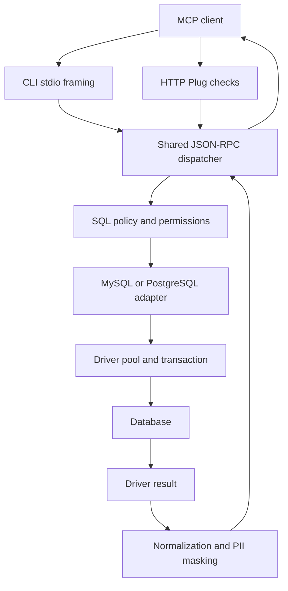

# Developer guide

The implementation uses two small Mix applications and one sibling library.
MyXQL and Postgrex own database connectivity; the shared core owns configuration,
SQL policy, MCP request handling, normalization/masking and transports. There is
no Ecto layer, Phoenix application, web UI or custom database protocol.

## Workspace layout

| Path | Responsibility |
| --- | --- |
| [`mcp-ex-core/mix.exs`](../mcp-ex-core/mix.exs) | Shared dependency declarations; Jason, Plug, Bandit and Decimal |
| [`config.ex`](../mcp-ex-core/lib/mcp_ex/config.ex) | Environment parsing, driver options, write permission lookup and tool capability hints |
| [`policy.ex`](../mcp-ex-core/lib/mcp_ex/policy.ex) | SQL lexer, single-statement classification, target checks and PII query guards |
| [`redact.ex`](../mcp-ex-core/lib/mcp_ex/redact.ex) | Database value normalization, sensitive-name detection, recursive masks and metadata filtering |
| [`server.ex`](../mcp-ex-core/lib/mcp_ex/server.ex) | JSON-RPC dispatch, initialization, tools, resources, result envelopes and safe errors |
| [`cli.ex`](../mcp-ex-core/lib/mcp_ex/cli.ex) | Escript lifecycle, pool startup/probe, transport choice and bounded stdio input |
| [`http.ex`](../mcp-ex-core/lib/mcp_ex/http.ex) | Plug handler, auth/origin/version checks, media types and bounded HTTP body handling |
| [`mysql.ex`](../mcp-ex-mysql/lib/mcp_ex/mysql.ex) | MyXQL pool, transaction execution, MySQL metadata SQL and CLI entry point |
| [`pg.ex`](../mcp-ex-pg/lib/mcp_ex/pg.ex) | Postgrex pool, startup parameters, transaction execution, schema metadata and CLI entry point |
| [`bin/check`](../bin/check) | Format/compile/test/build entry point for all three projects |
| [`test/`](../test) | Disposable SQL fixtures and official TypeScript SDK transport checks |
| [`compose.test.yml`](../compose.test.yml) | Local disposable MySQL/PostgreSQL databases |
| [`.worklog/`](../.worklog/status.md) | Task status, implementation decisions and verification evidence |
| [`mcp-server-mysql/`](../mcp-server-mysql/README.md) | Original TypeScript reference checkout |

Each application has its own `mix.lock`, `deps/` and `_build/`. The core is a
path dependency, not an umbrella application. Fetching an adapter application's
dependencies does not prepare the core's standalone build directory for its
own tests. Keep all three source folders together and fetch dependencies in each.

## Architecture and request flow



At startup, the dialect-specific CLI delegates to `McpEx.CLI.main/2`, which
validates configuration, starts the adapter pool and probes it through the
read-only execution path. It then enters the stdio loop or starts Bandit with
the context map as Plug options. Driver/library processes are linked; no custom
OTP Application supervisor or release lifecycle is defined.

For `tools/call`, the server validates the tool and arguments, checks policy,
executes the classified mode, builds row maps, filters SQL column metadata when
needed, applies normalization/masking and wraps JSON text plus timing text.
Expected tool failures become `isError: true`; RPC dispatch errors use the
JSON-RPC error envelope.

Resources are a separate metadata path. The server calls adapter-owned
parameterized catalog queries, bypassing the user-SQL policy that would block
catalog access in PII mode. It validates a table resource against the current
table inventory before reading columns, applies column-name filtering and
normalizes metadata. This path does not run the complete value-masking pass.

## Internal contracts

There is no declared Elixir adapter behaviour today; the two modules satisfy
the following convention. Keep shared policy out of adapters and native engine
details out of the core.

| Function | Contract |
| --- | --- |
| `dialect/0` | Returns `:mysql` or `:pg` |
| `start_link(config)` | Starts the driver pool and returns `{:ok, pool}` or a driver error |
| `execute(context, sql, values, mode)` | Accepts `:read`, `:write` or `:ddl`; returns `{:ok, result}` or `{:error, exception_or_reason}` |
| `tables(context)` | Returns a driver result with the canonical lowercase table metadata aliases |
| `columns(context, schema, table)` | Returns a driver result with canonical lowercase column aliases in ordinal order |

The context map is `%{pool: pool, adapter: adapter_module, config: config}`.
The result needs `columns`, `rows` and `num_rows`; MySQL may also provide
`last_insert_id`. `columns: nil` selects the command-result envelope. Otherwise
`McpEx.Server.rows/1` zips column names and each row into a map; duplicate names
are overwritten by the later value. Preserve canonical metadata aliases,
particularly MySQL's explicit lowercase aliases.

`McpEx.Config.load/2` accepts an injected string-keyed environment map for
isolated tests. `Config.allowed?/3` is the permission lookup;
`Config.read_only?/1` supplies client annotations. Policy `check/2` returns
`%{mode: mode, schema: schema, introspection: kind}` or raises `ArgumentError`.
Introspection kinds are `nil`, `:columns`, `:topology` and `:blocked`.

Write target extraction accepts at most two name components; keep third-component
rejection in that shared path for every write/DDL classifier. File-SQL guards
inspect words and quoted identifiers while leaving literal values alone.

`McpEx.Server.handle/3` returns `{response_or_nil, next_state}`. Stdio passes
`:new`, transitions to `:initializing` on initialization, then to `:ready` on
`notifications/initialized`. HTTP calls the default `:ready` handler separately
for each request. Incoming client response envelopes are ignored. Notifications
normally produce no response.

`Redact.normalize/1` runs independently of PII mode. `Redact.apply/2` adds
recursive masking when enabled. `filter_columns/2` operates on resource column
rows; `filter_introspection/2` accepts case-insensitive `Field` or `column_name`
keys and refuses a nonempty result shape that cannot be safely filtered.

## Database execution details

The MySQL adapter checks out one connection with `DBConnection.run/3`, applies
`SET TRANSACTION READ ONLY` using text protocol for the next read transaction,
then executes the user statement inside `MyXQL.transaction/3`. Reads deliberately
rollback with `{:read_result, result}` and unwrap that marker as success. Writes
commit. MySQL DDL uses a direct query because implicit commit prevents a useful
rollback wrapper.

The PostgreSQL adapter sets startup `search_path` to one quoted configured
schema (or an empty string), supplies `statement_timeout`, and selects unnamed
prepared statements. Execution uses `Postgrex.transaction/3`; reads set the
transaction read-only and use the same rollback-result pattern. Writes and DDL
commit on success. Do not replace native read-only enforcement with keyword
checks: functions, CTEs and EXPLAIN can have engine-level effects.

These engine boundaries and their limitations are detailed in
[Security](SECURITY.md#transaction-boundaries).

## Development setup and workflow

Follow [asdf/build setup](USER-GUIDE.md#install-and-build). Use RTK for coding
commands and the Ponytail workflow for minimal changes that reuse existing
modules. RTK is an agent/development tool, not a server runtime dependency.
`bin/check` uses it automatically when installed. The workspace RTK skill is in
[.worklog/skills/rtk/SKILL.md](../.worklog/skills/rtk/SKILL.md); use your installed
Ponytail skill for code changes.

Track scope, tasks and progress in `.worklog/`, then record exact validation and
remaining limits. Follow this change sequence:

1. Trace the affected shared handler and both adapter callers before editing.
2. Put common behavior in the core; keep database-specific SQL in the adapter.
3. Add a meaningful regression check for changed logic/security boundaries.
4. Format the affected project, then run the relevant checks.
5. Rebuild affected escripts and update user/developer docs when behavior changes.
6. Record what actually ran, its result, and any unexercised endpoint/version.

For example, from the workspace root:

```sh
(cd mcp-ex-core && rtk proxy mix format)
./bin/check
```

Run [integration checks](TESTING.md#full-integration-check) for changes involving
driver execution, policy enforcement, metadata, result encoding or transports.
For a quick source launch inside the MySQL application, after exporting its
database environment:

```sh
(cd mcp-ex-mysql && rtk proxy mix run -e 'McpEx.Mysql.CLI.main(["--stdio"])')
```

Substitute the PG directory and `McpEx.Pg.CLI` for PostgreSQL. Source launch can
include Mix compilation output on stdout; use a built escript for an actual
stdio MCP client. Shared-core edits require rebuilding both escripts; rebuilding
only the core does not replace code already embedded in either executable.

## Extending the implementation

For a new environment setting, update `Config.load/2`, validation tests,
[Configuration](CONFIGURATION.md) and any relevant `.env.example`. Preserve
strict parsing and defaults that deny writes. For a new SQL form, trace lexer,
statement classification, explicit target extraction, permission requirements,
PII guards and native transaction mode together. Test permitted and rejected
variants, including qualified targets and literals/comments that resemble
keywords. Do not add an unrestricted parser bypass to support one query.

For new metadata fields, keep lowercase aliases and parameterized schema/table
filters; update resource documentation and filtering tests. For protocol changes,
update both transports and lifecycle/HTTP checks. Run the SDK interoperability
script to catch client-level issues that Plug unit tests cannot show.

Adding a different database is more than returning a new dialect atom:
configuration prefixes, SQL lexical rules, resource schemes, tool names and
engine transaction behavior currently assume these two dialects. Extend those
explicit cases and supply live adapter checks before advertising another engine.

## Dependencies, versions and compatibility

`mix.exs` declares version ranges; committed lockfiles choose exact packages.
MySQL uses MyXQL `~> 0.9.0`; PostgreSQL uses Postgrex `~> 0.22.0`. Bandit is
restricted to `~> 1.13.1` and Decimal to `~> 3.1.2`, establishing patched minimums.
Avoid adding runtime dependencies when the standard library or current modules
cover the requirement. Fetch/update dependencies
deliberately in the relevant projects and review all affected locks; core
dependencies can resolve separately in each consumer.

Both Mix applications and the server-info response currently report `0.1.0`.
The response version is hardcoded in `server.ex`, so a release version change
must update it alongside the Mix project versions. Supported MCP versions are
listed in `Server.versions/0`; do not infer support for unlisted versions from
the client's package version.

Compared with the TypeScript reference, these implementations keep the query,
permissions, PII, table resources and dual transports, while using qualified
resource URIs, working root reads, exact bearer comparison and redaction of
write results. Deliberate differences include default-scoped discovery,
database-URL-only connection strings, external dotenv/tunnel handling, strict
write shapes and read-only enforcement that cannot be disabled. No arbitrary
DDL, mysql2 option aliases, HTTP sessions, prompts or OAuth service are supplied.

See [recorded test evidence](TESTING.md#recorded-evidence-and-limits) before
claiming support for a new runtime, database version, TLS setup or socket path.
